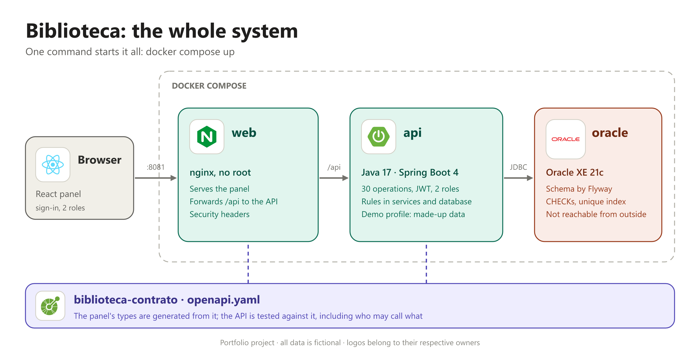
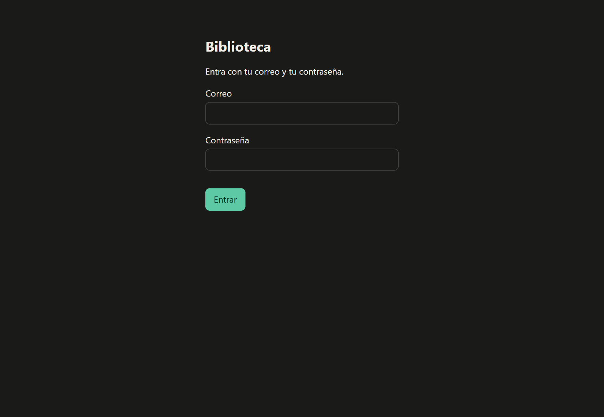
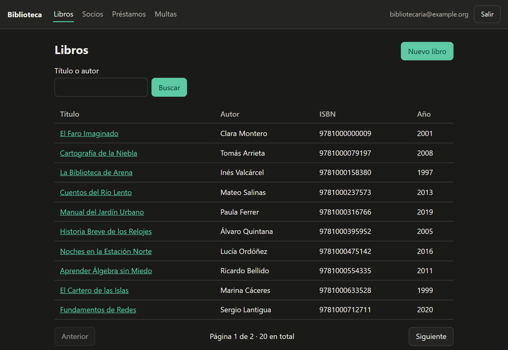
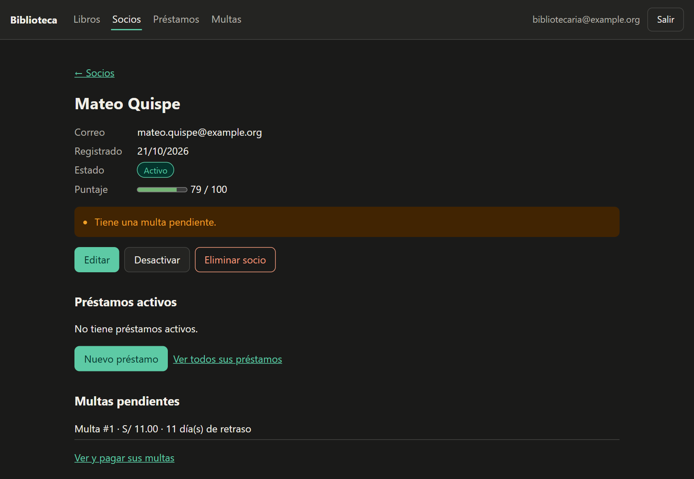
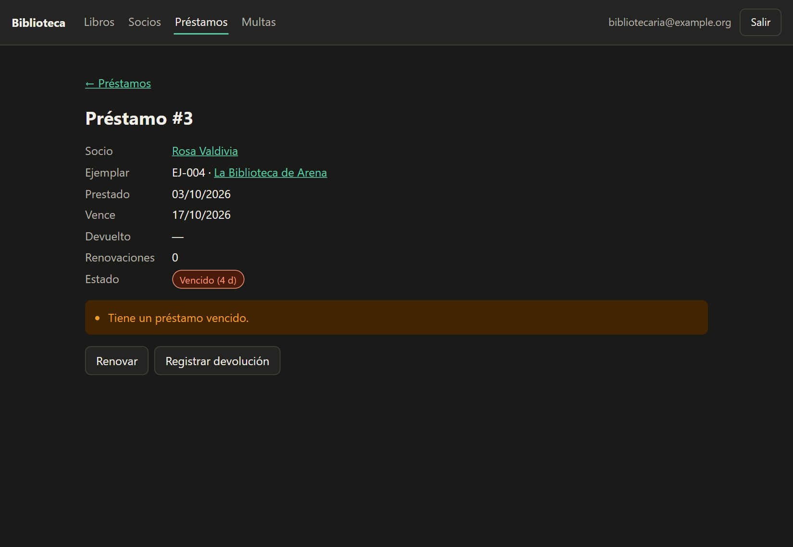
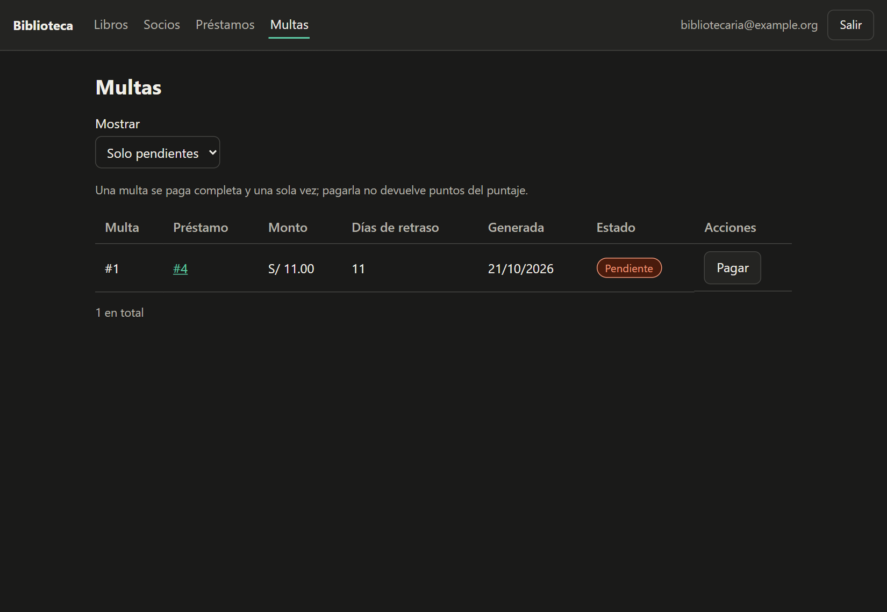
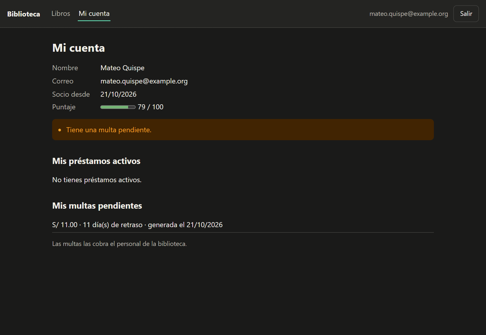

# biblioteca

[](LICENSE)


A small library system built end to end: a **REST API** with its rules enforced by the database, **sign-in with JWT and two roles**, a **shared API contract**, and a **React panel** for librarians and members. This repository is the front door of the project: it starts everything with one command and explains how the pieces fit.

> All data in this project is fictional. It is a portfolio project and is not related to any real organization.



| | |
|---|---|
|  |  |
|  |  |
|  |  |

## Run it

You need [Docker](https://www.docker.com/) (with Compose). Nothing else: Java, Node and Oracle all run in containers.

```bash
git clone https://github.com/caronteisback/biblioteca.git
cd biblioteca
cp .env.example .env
docker compose up --build
```

Open <http://localhost:8081> and sign in with one of the demo accounts below.

The first start downloads the Oracle image and builds the API and the panel, so it takes a few minutes; later starts take about a minute. The API loads a made-up library and three accounts on its first start, so every screen has something to show. To stop it, press `Ctrl+C`; to remove the containers and the database, run `docker compose down -v`.

The example values in `.env.example` are fine for a demo on your own machine: nothing but the panel is published, and only on `127.0.0.1`. Change them (the signing key above all: `openssl rand -base64 48`) for anything else.

### Demo accounts

The password of all three is the `DEMO_PASSWORD` of your `.env` (`change_me_demo_password` in the example).

| Account | Role | What to try |
|---------|------|-------------|
| `bibliotecaria@example.org` | Librarian | The whole panel: lend a copy, renew the overdue loan (it is refused, and the panel says why), pay a fine |
| `mateo.quispe@example.org` | Member | "Mi cuenta": a score of 79 and a **pending fine**. The catalog is read-only; the librarian screens answer "Sin permiso" |
| `rosa.valdivia@example.org` | Member | "Mi cuenta": an **overdue loan** |

### What is in the demo

20 books with their copies and 8 members, with loans in every state: due soon, renewed, overdue, returned late with a **pending fine** (that member cannot borrow), returned late and paid, a deactivated member and a retired copy.

### If something goes wrong

- **`failed to execute bake`** while building: some Docker Desktop versions fail to hand a build from a Git address to the new builder. Use the classic one: `COMPOSE_BAKE=false docker compose up --build`.
- **Docker Hub pull limits** on the Oracle image: set `ORACLE_IMAGE=ghcr.io/gvenzl/oracle-xe:21-slim-faststart` in `.env`.
- **Port 8081 is taken**: change `WEB_PORT` in `.env`.
- **The API stops at startup** saying the key is too short: `JWT_SECRET` needs at least 32 characters.
- **Start again from nothing** (database included): `docker compose down -v`.

## The pieces

| Repository | What it is | Version |
|------------|------------|---------|
| [biblioteca-java](https://github.com/caronteisback/biblioteca-java) | The API: Java 17, Spring Boot 4, JPA and Oracle XE 21c, JWT and two roles, with 399 tests on a real database | v0.3.1 |
| [biblioteca-web](https://github.com/caronteisback/biblioteca-web) | The panel: React, TypeScript and Vite, with 143 tests including whole journeys for a librarian and a member and an accessibility check of every screen | v0.2.1 |
| [biblioteca-contrato](https://github.com/caronteisback/biblioteca-contrato) | The contract: one OpenAPI 3.1 file that the API is tested against and the panel's types are generated from | v0.2.1 |

`docker-compose.yml` builds the API and the panel from their repositories at those tags, so what runs is what each tag released. To build from folders on your machine instead, set `API_SOURCE` and `WEB_SOURCE` in `.env` (see `.env.example`).

## Ideas worth a look

- **Contract first.** The API and the panel never describe each other by hand: both follow `openapi.yaml`. The panel's types are generated from it, so a call the contract does not describe does not compile, and a test calls the real API and checks every status, body and error code against the contract.
- **Access control that the contract checks.** One list in the API says who may call what; it enforces it and publishes it in the OpenAPI description. A test walks every operation of the contract with no token, a librarian's and a member's, and checks the answer is the one the contract declares. A member's data is read from the token, never from the request, so there is no way to ask for someone else's.
- **Rules where they cannot be skipped.** A copy cannot have two active loans because the database says so (a unique index), and the services say it first with a clear error. Concurrent requests are serialized with row locks in a fixed order, and tests with real threads prove it.
- **Calculated, never stored.** The member's score, the alerts and the availability of a copy are computed from the history when asked, so they cannot go stale.
- **One error shape.** Every failure is `{ code, message }` with a stable code, also for the security filters; the panel has a Spanish message for each code, and the build fails if the contract adds a code without one.
- **Safe by default.** No secrets in the repositories; passwords stored as salted hashes; a wrong email and a wrong password look the same, and five failures lock an email; the signing key has no default; the database is not reachable from outside; the panel is served by nginx without root with a strict Content-Security-Policy; and the API never leaks SQL or stack traces.
- **Bugs found by testing the real thing.** Putting the pieces together found a bug that no unit test could: every write through nginx was refused, because the proxy dropped the port from the `Host` header and the API took the browser's own `Origin` for another site. It is fixed, and a CI check now reproduces it.

## Limits

- **The panel and the API speak plain HTTP**, so the password and the token would travel in clear on a network: this setup is bound to `localhost`. Put HTTPS in front of it before exposing it.
- **There is no operation to create or manage accounts**: they come from the environment and the demo data. Tokens last 60 minutes and cannot be revoked earlier; the sign-in lock counts failures in the memory of one API instance.
- The panel's screens are in Spanish; the code, the API contract and the documentation are in English.

## License

[MIT](LICENSE).
